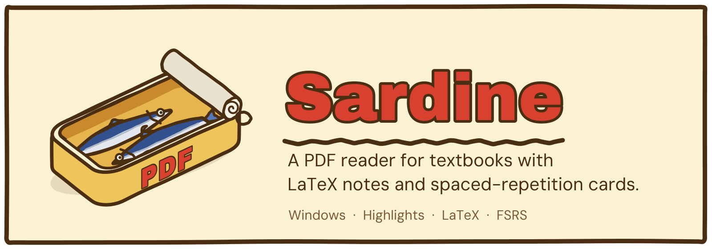

<p align="center">
  
</p>

<p align="center">
  <a href="../../releases/latest"><b>Download for Windows</b></a> ·
  <a href="#get-the-windows-installer-without-installing-anything-github-actions">Build it yourself</a>
</p>

---

A PDF reader for textbooks with highlights, LaTeX notes, and spaced-repetition flashcards. It's a desktop app for Windows, built with Tauri (Rust + Svelte).

Inspired by "orbit" but for Windows by Andy Matuschak. combine pdf annotation with Spaced repetition  like Anki.
Video Reference: https://www.youtube.com/watch?v=OFuu4pesKf0

- **Rust backend** (`src-tauri/`): renders pages with pdfium (`pdfium-render`) on a dedicated worker thread and streams them to the UI through a `pdf://` protocol. It also extracts the text geometry used for selection, plus the outline, metadata, covers and region snips. Books are copied into the app's data folder, and notes, cards and settings are stored as JSON files there.
- **Svelte frontend** (`src/`): the library, the reader (contents / notes / bookmarks sidebar and page bar), Flashcard mode, the card editor with live KaTeX preview, review, and the light / sepia / dark themes.

Data lives in `%APPDATA%\com.quant.margin\` on Windows (`books\`, `covers\`, `store\*.json`). The folder keeps the app's original name, Margin, so existing notes carry over. Settings ▸ shows the exact path.

## Get the Windows installer without installing anything (GitHub Actions)

1. Create a new **empty** GitHub repository and push this folder to it:
   ```
   git init
   git add .
   git commit -m "Sardine"
   git branch -M main
   git remote add origin https://github.com/<you>/margin.git
   git push -u origin main
   ```
2. On GitHub, open **Actions ▸ Build Windows app**. The first build takes about 10–15 minutes.
3. When it's green, open the run and download **Sardine-windows** under *Artifacts*. Unzip it and run `Sardine_0.1.0_x64-setup.exe`.
   - Windows SmartScreen will warn because the app isn't code-signed. Click **More info ▸ Run anyway**.
4. To publish a proper release, tag it: `git tag v0.1.0 && git push --tags`. The installer is attached to a GitHub Release.

## Build on your own PC

One-time setup:
- [Rust](https://rustup.rs) (choose the default MSVC toolchain; the installer offers the Visual Studio C++ Build Tools)
- [Node.js 22 LTS](https://nodejs.org)
- WebView2 is already on Windows 10/11.

Then, in PowerShell in this folder:
```powershell
npm install
./scripts/get-pdfium.ps1         # puts pdfium.dll in src-tauri/pdfium/
npm run tauri dev                # run with hot reload
npm run tauri build              # make the installer
```
The installers end up in `src-tauri/target/release/bundle/nsis/` (.exe) and `.../msi/` (.msi).

## Moving over from the single-file HTML version

In the old `Margin.html`, use **⋯ ▸ Back up annotations (.json)**. In the app, use **☰ ▸ Restore from backup…**. Books appear with a **Locate file…** badge; click one and pick the same PDF. The file is fingerprinted the same way, so your highlights and cards reattach.

## Licences

pdfium is BSD-3/Apache-2.0, and `pdfium-render` is MIT/Apache-2.0. The UI design is inspired by Readest; no Readest code is used.
